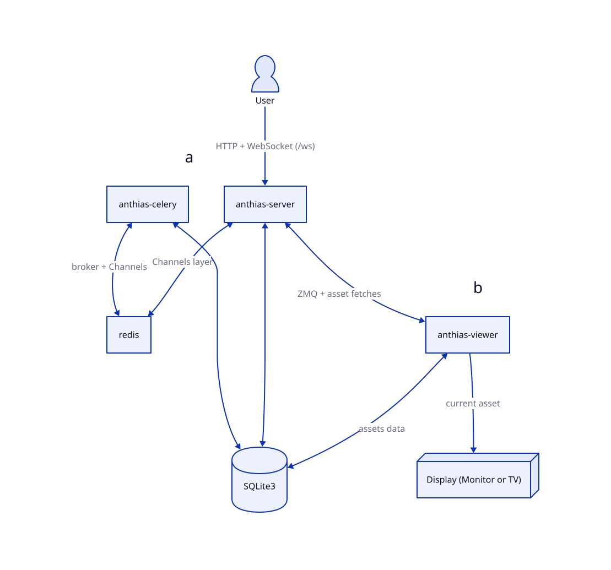

## Understanding the components that make up Anthias

Here is a high-level overview of the different components that make Anthias:



These components and their dependencies are mostly installed and handled with Ansible and Docker.

* The **web app** component (`anthias-server`) serves every HTTP route, behind the Caddy front end, via uvicorn (ASGI). It runs the Django front-end + REST API, serves static assets via WhiteNoise, streams uploaded media at `/anthias_assets/`, and exposes the WebSocket endpoint at `/ws` via Django Channels. `/ws` follows the same authentication switch as the rest of the app: with **Authentication** set to **Basic auth** in Settings, the handshake must carry a logged-in browser session or it is refused; with authentication disabled the endpoint is open, like every other surface on the device. Authorization does not outlive the handshake. Turning authentication on, or rotating the operator's username or password (from the settings page, the API, or the Django admin), closes every open socket; with authentication enabled, any socket that survives the close — the close is best-effort, since it travels over Redis — stops receiving updates from that moment on. (Rotating credentials while authentication is *disabled* closes the sockets too, but a survivor keeps working: in that mode the device is open by contract and there are no credentials in force to revoke.) (That last guarantee covers changes made through the web app, which is the process holding the sockets; a password changed by `manage.py changepassword` on the device relies on the close alone.) Turning authentication *off* also closes them, but a socket that survives that close keeps working, because the device is open by contract in that mode and there is nothing left to revoke. It speaks plain HTTP inside the Docker network only; the **anthias-caddy** front end terminates TLS on ports 80 and 443 for every install (see [TLS / SSL](/docs/#tls--ssl)).
* The **viewer** (`anthias-viewer`) is what drives the screen (e.g., shows web page, image or video). It fetches media from `anthias-server` over HTTP.
* The **Celery** (`anthias-celery`) component is for asynchronously queueing and executing tasks outside the HTTP request-response cycle (e.g., yt-dlp downloads, asset cleanup). It pushes asset-update events to connected WebSocket clients via the Redis-backed Channels layer.
* **Redis** (`redis`) is used as the Celery broker/result backend and as the Channels channel layer.
* **Caddy** (`anthias-caddy`) is the web front end on every install. It owns host ports 80 and 443 (and 8443 for [multi-screen management](/docs/multi-screen/) while the device is a controller or a managed screen), terminates TLS and proxies to `anthias-server`. `anthias-server` generates its configuration.
* The **database** component uses **SQLite** for storing the assets information.

## Dockerized development environment

To simplify development of the server module of Anthias, we've created a Docker container. This is intended to run on your local machine with the Anthias repository mounted as a volume.

> **Important**
>
> * Make sure that you have [installed Docker](https://docs.docker.com/engine/install/) on your machine before proceeding.
> * Anthias is using Docker's [buildx](https://docs.docker.com/engine/reference/commandline/buildx/) for the image builds. This is used both for cross compilation as well as for local caching. You might need to run `docker buildx create --use` first.

Assuming you're in the source code repository, simply run:

```bash
$ ./bin/start_development_server.sh

# The console output was truncated for brevity.
# ...

[+] Running 4/4
 ✔ Network anthias_default                Created                            0.1s
 ✔ Container anthias-redis-1              Started                            0.2s
 ✔ Container anthias-anthias-server-1     Started                            0.3s
 ✔ Container anthias-anthias-celery-1     Started                            0.4s
```

> **Note**
>
> The script first renders the Dockerfiles from their templates inside a helper
> Docker container (Python and [uv](https://docs.astral.sh/uv/) run there, not on
> your machine), then builds and starts the `anthias-server`, `anthias-celery` and
> `redis` containers from `docker-compose.dev.yml`. This keeps the development
> environment consistent across different machines.

Running the command above will start the development server and you should be able to
access the web interface at `http://localhost:8000`.

To stop the development server, run the following:

```bash
docker compose -f docker-compose.dev.yml down
```

## Building containers on the Raspberry Pi

> **Note**
>
> Make sure that you have Docker installed on the device before proceeding.

```bash
$ ENVIRONMENT=production \
    ./bin/generate_dev_mode_dockerfiles.sh
$ MODE=build \
    ./bin/upgrade_containers.sh
```

## Django admin site

Create a superuser account:

```bash
$ export COMPOSE_FILE=docker-compose.dev.yml
$ docker compose exec anthias-server \
    python manage.py createsuperuser
# You will be prompted to enter a username, an email address, and a password.
```

Once you have created a superuser account, you can open the Django admin site at `http://localhost:8000/admin/` (with a trailing slash)
and login with the credentials you just created.


## Testing
### Running the unit tests

Build and start the containers.

```bash
$ uv run python -m tools.image_builder \
  --dockerfiles-only \
  --disable-cache-mounts \
  --service redis \
  --service test
$ docker compose \
    -f docker-compose.test.yml up -d --build
```

Run the unit tests.

```bash
$ docker compose \
    -f docker-compose.test.yml \
    exec anthias-test bash ./bin/prepare_test_environment.sh -s

# Integration and non-integration tests should be run separately as the
# former doesn't run as expected when run together with the latter.

$ docker compose \
    -f docker-compose.test.yml \
    exec anthias-test pytest -n auto -m "not integration"

$ docker compose \
    -f docker-compose.test.yml \
    exec -e ANTHIAS_INTEGRATION_TEST=1 anthias-test \
    pytest -m integration --reuse-db
```

The unit tests (everything except the integration suite) can also run directly on
your machine, without Docker or Redis:

```bash
$ uv sync --group test
$ uv run pytest -m "not integration"
```

### The QA checklist

We've also provided a [checklist](/docs/qa/) that can serve as a guide for testing Anthias manually.

## Generating CSS and JS files

To get started, you need to start the development server first. See this [section](#dockerized-development-environment)
for details.

### Starting the bundler in development mode

To start [Bun](https://bun.sh/) in development (watch) mode, run the following command:

```bash
$ docker compose -f docker-compose.dev.yml exec anthias-server \
    bun run dev
```

This runs `bun build --watch` for JS/TS and `sass --watch` for SCSS in parallel.
Making changes to the TypeScript, TSX, or SCSS files will automatically trigger a recompilation,
generating the corresponding bundle and CSS files.

### Formatting and linting TypeScript code

To run the linting and formatting checks on the TypeScript code, run the following command:

```bash
$ docker compose -f docker-compose.dev.yml exec anthias-server \
    bun run lint:check
$ docker compose -f docker-compose.dev.yml exec anthias-server \
    bun run format:check
```

If you want to fix the linting errors and formatting issues, run the following command:

```bash
$ docker compose -f docker-compose.dev.yml exec anthias-server \
    bun run lint:fix
$ docker compose -f docker-compose.dev.yml exec anthias-server \
    bun run format:fix
```

### Closing the transpiler

Just press `Ctrl-C` to close the bundler watch.

## Linting Python code locally

The project uses `ruff` for linting the Python codebase. While the linter is being run on the CI/CD pipeline,
you can also run it locally. There are several ways to do this.

### Run the linter using `act`

[`act`](https://nektosact.com/) lets you run GitHub Actions locally. This is useful for testing the CI/CD pipeline locally.
See the [act installation instructions](https://nektosact.com/installation/index.html).

After installing and setting up `act`, run the following command:

```bash
$ act -W .github/workflows/python-lint.yaml
```

The command above will run the linter on the all the Python files in the repository. If you want to run the linter
on a specific file, you can try the commands in the next section.

### Running the linter using `uv`

You have to install `uv` first. See the
[uv installation instructions](https://docs.astral.sh/uv/getting-started/installation/).

After installing uv, run the following commands:

```bash
# Install the dependencies
$ uv venv
$ uv pip install --group dev-host
$ uv run ruff check .
```

To run the linter on a specific file, run the following command:

```bash
$ uv run ruff check /path/to/file.py
```


## Managing releases
### Creating a new release

Anthias uses CalVer versions, `YYYY.0M.MICRO` (for example `2026.11.1`), tagged
as `v2026.11.1`. To cut a release:

1. Bump the version in `package.json`, `pyproject.toml` (both zero-padded, e.g.
   `2026.11.1`) and `uv.lock` (strict semver, without the leading zero: `2026.6.0` for
   `2026.06.0`), and merge that to `master`.
2. Wait for the `master` Docker build to finish for every board. The release
   pipeline checks that those images exist.
3. Create the GitHub release as a draft, so the tag isn't created yet:

```bash
$ gh release create v2026.11.1 \
    --draft --generate-notes \
    --title 2026.11.1 \
    --target "$(git rev-parse origin/master)"
```

4. Publish it. Publishing creates the tag and starts the pipeline that deploys
   to the balena fleets and builds the disk images attached to the release:

```bash
$ gh release edit v2026.11.1 --draft=false --latest
```

### Delete a broken release

If something is wrong while the release is still a draft, delete the draft;
no tag has been created yet:

```bash
$ gh release delete v2026.11.1
```

## Directories and files explained

In this section, we'll explain the different directories and files that are
present in a Raspberry Pi with Anthias installed.

### `/home/${USER}/anthias/`

* All of the files and folders from the Github repo should be cloned into this directory.
* On installations created before the rename, this directory is `/home/${USER}/screenly/`: the installer migrates it to `anthias/` on upgrade and leaves a back-compat symlink at the old path for one release.

### `/home/${USER}/.anthias/`

* `default_assets.yml`: configuration file which contains the default assets that get added to the assets list if enabled
* `anthias.conf`: configuration file for web interface settings
* `anthias.db` &ndash; database file containing current assets information.
* On pre-rename installations this directory is `~/.screenly/` containing `screenly.conf` / `screenly.db`; the installer migrates them.


### `/etc/systemd/system/`

* `anthias-host-agent.service`: runs the host agent (`python -m anthias_host_agent`, from `src/anthias_host_agent/`), which publishes host facts (such as memory and board model) into Redis for the containers, and listens on Redis for commands such as rebooting or shutting down the device.

### `/etc/sudoers.d/anthias_overrides`

* `sudoers` configuration file that allows the Anthias user to execute certain `sudo` commands without being a superuser (i.e., `root`)

### `/usr/share/plymouth/themes/anthias`

* `anthias.plymouth`: Plymouth config file (sets module name, `ImageDir` and `ScriptFile` dir)
* `anthias.script` &ndash; plymouth script file that loads and scales the splash screen image during the boot process
* `splashscreen.png`: the splash screen image that is displayed during the boot process

## Debugging the Anthias WebView

```
export QT_LOGGING_DEBUG=1
export QT_LOGGING_RULES="*.debug=true"
export QT_QPA_EGLFS_DEBUG=1
```

The Anthias WebView is a custom-built web browser based on the [Qt](https://www.qt.io/) toolkit framework.
The browser is assembled with a Dockerfile (`src/anthias_webview/Dockerfile`); the Qt 5 build for the 32-bit boards is driven by `src/anthias_webview/build_qt5.sh`.

For further info on these files and more, browse the [`anthias_webview` source directory on GitHub](https://github.com/Screenly/Anthias/tree/master/src/anthias_webview).

## Related documentation

- [QA checklist](/docs/qa/): the manual testing guide referenced above.
- [Installation options](/docs/install/): set up a device to test your changes on.
- [API reference](/api/): the REST API you'll build against.
- [All documentation](/docs/): the full Anthias documentation index.
